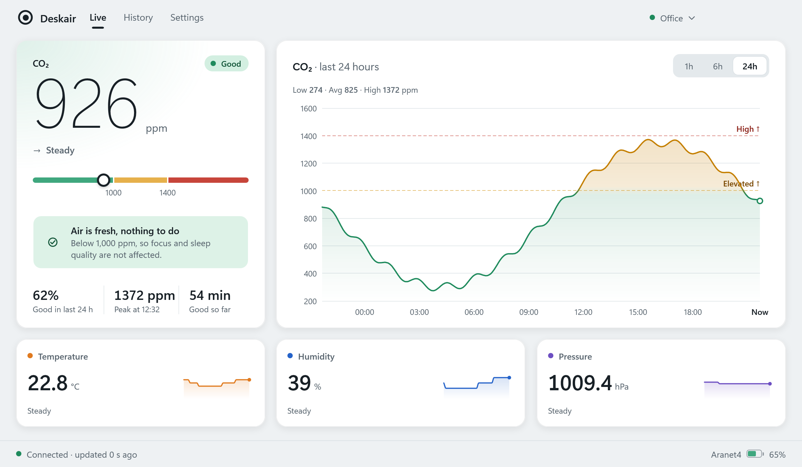
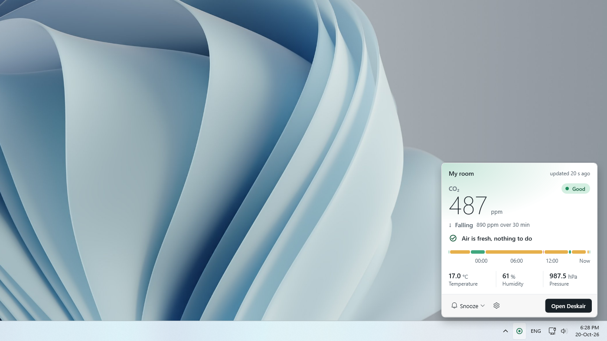
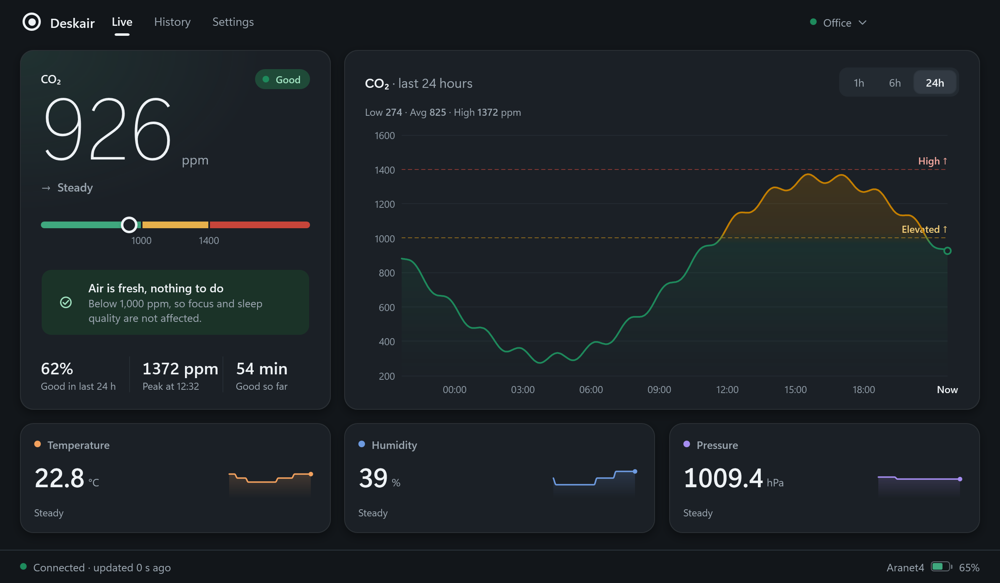
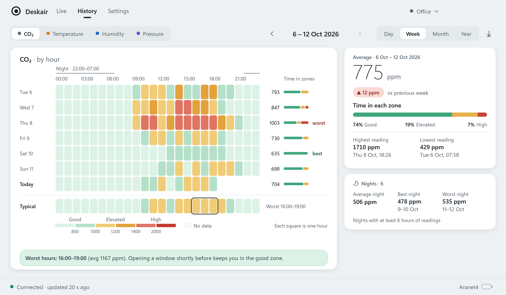
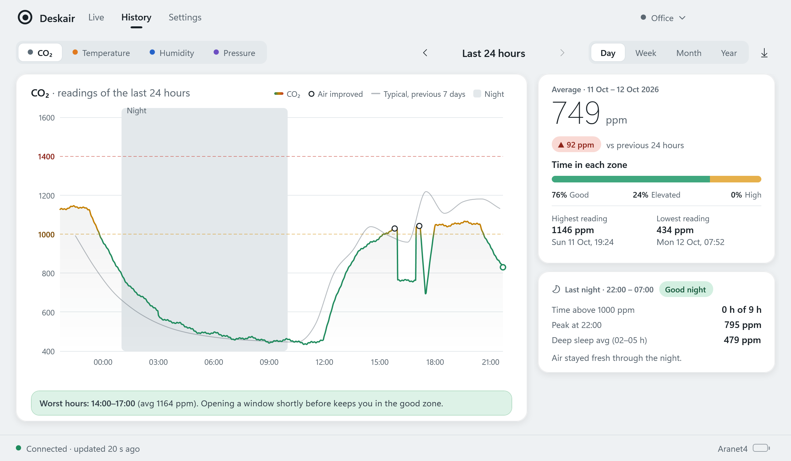

# Deskair

**A Windows desktop monitor for the Aranet4 CO₂ sensor.** See your air quality live, get a gentle alert when the room needs fresh air, and look back over days, weeks and months. Everything stays on your PC.

> **Unofficial.** Deskair is an independent open-source project. It is not made by, affiliated with or endorsed by the maker of Aranet4. Aranet is a trademark of its owner. Privacy: [`PRIVACY.md`](PRIVACY.md).



## Features

- **Live:** CO₂ in large numbers with a clear zone (Good, Elevated or High), plain advice such as "Open a window for about 10 minutes", and temperature, humidity and pressure with trend charts. Charts cover 1 hour, 6 hours or 24 hours.
- **Tray:** an icon that changes colour with the air quality, a quick flyout on left-click and a menu on right-click.
- **Alerts:** a Windows notification when the air stays high, with Snooze. It respects quiet hours and Windows Do Not Disturb, and never sends a second toast for the same episode.
- **History:** day, week, month and year views, a typical day, night-only averages and the hours when the air is usually worst. Gaps stay gaps: Deskair never invents data, and it says how complete a period is.
- **Private:** no account, no cloud, no tracking. Readings are saved as CSV files in `Documents\Deskair`, and you can export them.
- **Languages:** English and Ukrainian, light and dark themes, Celsius and Fahrenheit.
- **Also:** can start with Windows (straight into the tray), keeps running in the tray when you close the window, and catches up on the sensor's stored history after sleep.

| Tray flyout | Dark theme |
|---|---|
|  |  |

| History by week | History for one day |
|---|---|
|  |  |

*The screenshots use sample data.*

## What you need

- An **Aranet4** sensor.
- In the **Aranet Home** phone app, switch on **Smart Home integration** for the sensor. Without it the sensor refuses the readings Deskair asks for.
- A Windows PC with Bluetooth LE: Windows 11, or Windows 10 version 2004 or later. Windows 10 has not been tried yet.

## Install

- **Microsoft Store:** submitted for review; a link will appear here when it is published.
- **From source:** see below.

## Build and run

You need Windows and the .NET 10 SDK. WPF cannot be built on Linux or macOS.

```
dotnet build Deskair.sln
dotnet test tests/Deskair.Tests
dotnet run --project src/Deskair.App
```

No sensor at hand? Run the app on a simulated one. It uses its own temporary data folder, so your real data is untouched:

```
dotnet run --project src/Deskair.App -- --simulated
```

More switches (a control gallery, one real sensor by address, the first-run screen, a test toast) are listed in [`AGENTS.md`](AGENTS.md).

## How it works

The code is split into five projects with one-way dependencies: `Domain` (types and pure calculations), `Services` (sync, live feed, alerts, queries), `Sensors` (one folder per sensor), `Storage` (monthly CSV files and settings) and `App` (WPF views and view models). Another sensor can be added without touching the rest; see [`docs/guides/adding-a-sensor.md`](docs/guides/adding-a-sensor.md).

## Troubleshooting

- **"Not connected" or no readings:** check that Bluetooth is on and that Smart Home integration is on for the sensor in the Aranet Home app.
- **No toasts:** Windows Do Not Disturb may be holding them; Deskair says so in Settings.
- **Logs (running from source):** `%LOCALAPPDATA%\Deskair\logs`.

## Documentation

- Start at [`docs/00-index.md`](docs/00-index.md): product rules, design, data model, architecture and decisions.
- Design prototype: [`design/prototype/index.html`](design/prototype/index.html).
- Contributing: [`CONTRIBUTING.md`](CONTRIBUTING.md).

## License

[MIT](LICENSE).
