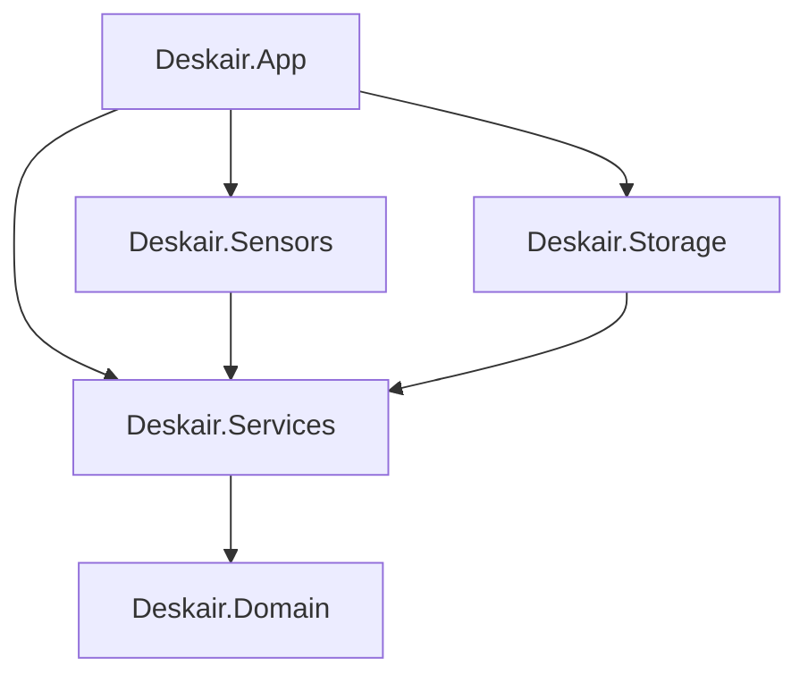
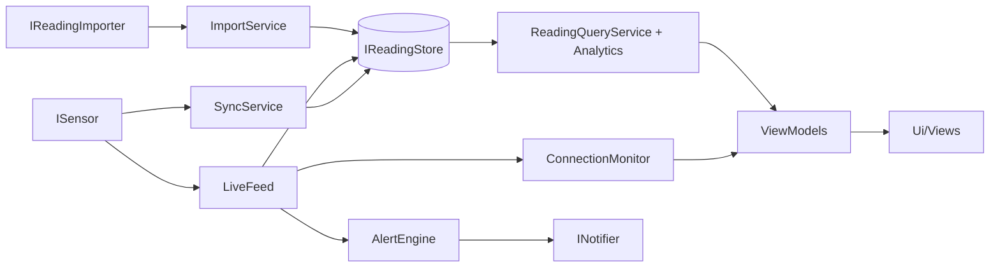

# Architecture

*Last reviewed: 2026-10-20*

Status: approved structure; details may change during M1. Behaviour is in `docs/product/`, visuals in `docs/design/`, storage in `data-model.md`, decisions in `docs/decisions.md`.

## 1. Goals

1. **Sensor-agnostic.** Logic, storage and UI know nothing about a vendor. A new sensor is a folder (see `docs/guides/adding-a-sensor.md`).
2. **Readable.** One public type per file, one UI control per folder, short files (section 11).
3. **Pure logic.** Rules and calculations have no UI, file or Bluetooth code and are easy to test.
4. **Compiler-enforced direction.** Dependencies point one way, protected by project references.
5. **Not more than needed.** Five projects and one test project.

## 2. Solution

| Project | Target | Contains | May depend on | Must never contain |
|---|---|---|---|---|
| `Deskair.Domain` | net10.0 | `Reading`, `Zone`, `Metric`, thresholds, calendar and DST helpers, and `Analytics/` (aggregation, coverage, trend, typical day, hours filter) | nothing | files, async I/O, current time, UI, Bluetooth |
| `Deskair.Services` | net10.0 | Workflows (sync, live feed, connection state, alert rules, queries, import and export) and the interfaces they need from outside: `ISensor`, `IBleConnection`, `IReadingStore`, `INotifier`, `ISettingsStore` | Domain | WPF, Windows APIs, file access, any concrete sensor, user-visible text |
| `Deskair.Sensors` | net10.0 | `Aranet4/` (parser, client, phone-export importer), `Simulated/`, one folder per extra sensor | Services, Domain | WPF, Windows APIs, file access |
| `Deskair.Storage` | net10.0 | Monthly CSV readings, merge rule, in-memory index, `device.json`, settings, CSV export | Services, Domain | UI, Bluetooth |
| `Deskair.App` | net10.0-windows10.0.19041.0 | WPF UI, view models, localization, Windows glue, startup wiring | all four | business rules |
| `tests/Deskair.Tests` | net10.0-windows10.0.19041.0 | Tests, with folders mirroring the projects | all | |



(`App` also references `Domain` directly. An arrow means "depends on".)

## 3. Dependency rules

Enforced by project references (compiler) and by one test class `Architecture/DependencyRulesTests` (namespace checks):

1. Only `Deskair.App.Composition` may use types from `Deskair.Sensors`. `Ui`, `ViewModels`, `Localization` and `Platform` must not.
2. `Ui` and `ViewModels` must not use `Deskair.Storage` or `Deskair.App.Platform`; they talk to `Services` only.
3. `ViewModels` must not use `System.Windows`.
4. `Domain`, `Services`, `Sensors` and `Storage` must not use `System.Windows` or `Windows.*`.
5. `Domain` must not use `System.IO` or `TimeProvider`/`DateTime.Now` (time is passed in).
6. No user-visible text outside `Deskair.App`. Lower layers produce structured data (a zone changed, N days are missing) and the app turns it into words.

## 4. Folder layout

```
src/Deskair.Domain/
  Readings/  Reading.cs  DeviceId.cs  SensorStatus.cs
  Zones/     Zone.cs  ZoneThresholds.cs  ZoneClassifier.cs
  Metrics/   Metric.cs  MetricDescriptor.cs
  Time/      Period.cs  LocalCalendar.cs  TimeSlot.cs
  Analytics/ Aggregation/  Coverage/  Trend/  TypicalDay/  HoursFilter/  HourGrid/

src/Deskair.Services/
  Sensors/        ISensorProvider.cs  ISensor.cs  IBleConnection.cs  IBleScanner.cs  IReadingImporter.cs
  Sync/           SyncService.cs  SlotMerger.cs
  Live/           LiveFeed.cs
  Connection/     ConnectionMonitor.cs  ConnectionState.cs
  Alerts/         AlertEngine.cs  AlertPolicy.cs  INotifier.cs  IDoNotDisturb.cs
  Queries/        ReadingQueryService.cs  (the only way view models get data)
  Import/         ImportService.cs  ExportService.cs  IReadingExporter.cs
  Devices/        DeviceRegistry.cs  IDeviceStore.cs
  Settings/       AppSettings.cs  SettingsService.cs  ISettingsStore.cs
  Storage/        IReadingStore.cs
  Messages/       ReadingReceived.cs  ZoneChanged.cs  ConnectionStateChanged.cs  SettingsChanged.cs  LanguageChanged.cs
  Platform/       IBluetoothRadio.cs  IStartupRegistration.cs  IKnownFolders.cs  ISystemTheme.cs  IUiDispatcher.cs

src/Deskair.Sensors/
  Aranet4/    Aranet4Provider.cs  Aranet4Sensor.cs  Aranet4Protocol.cs  Aranet4Parser.cs
              PhoneExportImporter.cs  Aranet4Registration.cs
  Simulated/  SimulatedProvider.cs  SimulatedSensor.cs

src/Deskair.Storage/
  Readings/  MonthlyCsvStore.cs  ReadingIndex.cs  CsvReadingFormat.cs
  Devices/   DeviceFileStore.cs
  Settings/  JsonSettingsStore.cs
  Export/    CsvExporter.cs

src/Deskair.App/
  ViewModels/    Shell/  Live/  History/  Settings/  Onboarding/  Connection/  Flyout/  ChartModels/
  Localization/  Strings.resx  Strings.uk.resx  Localizer.cs  LanguageService.cs  PluralRules.cs
  Ui/            Theme/  Controls/  Charts/ (Layers/)  Views/ (includes Gallery/)  Markup/ (the {loc:T} extension, converters)
  Platform/      Bluetooth/  Tray/  Notifications/  Theming/  Startup/  Power/  KnownFolders/  Threading/
  Composition/   ServiceRegistration.cs  StartupSequence.cs  SingleInstance.cs  AppOptions.cs
  Themes/        Generic.xaml (registers every control template)
  App.xaml  Program.cs
```

## 5. Sensor-agnostic design

A sensor only has to give four measurements per reading.

```csharp
// Domain
public readonly record struct Reading(DateTimeOffset Timestamp,
    double Co2Ppm, double TemperatureC, double HumidityPct, double PressureHpa);
public readonly record struct DeviceId(string ProviderId, string Address);

// Services/Sensors: what a sensor must provide
public interface ISensorProvider                    // one per sensor family
{
    string Id { get; }                              // "aranet4"
    string DisplayNameKey { get; }                  // resource key, never text
    IReadOnlyList<string> OnboardingStepKeys { get; }
    IAsyncEnumerable<DiscoveredSensor> ScanAsync(CancellationToken ct);
    ISensor Create(DeviceId id);
    IReadOnlyList<IReadingImporter> Importers { get; }
}

public interface ISensor : IAsyncDisposable
{
    SensorCapabilities Capabilities { get; }        // History, Battery, SignalStrength, Broadcasts
    Task<SensorStatus> ConnectAsync(CancellationToken ct);   // interval, battery, signal
    Task<Reading> ReadCurrentAsync(CancellationToken ct);
    IAsyncEnumerable<Reading> ReadHistoryAsync(DateTimeOffset since, CancellationToken ct);
    IAsyncEnumerable<SensorBroadcast> ListenAsync(CancellationToken ct);  // only if Capabilities.Broadcasts: readings the sensor announces without a connection (D-0028)
}

// Services/Sensors: only what the Aranet4 driver really needs
public interface IBleConnection : IAsyncDisposable
{
    Task ConnectAsync(string address, CancellationToken ct);
    Task<byte[]> ReadAsync(Guid service, Guid characteristic, CancellationToken ct);
}
```

- **Protocol versus transport.** The Aranet4 folder knows UUIDs and byte layouts and talks to `IBleConnection`. `App/Platform/Bluetooth` implements it with the Windows Bluetooth LE APIs. Parsers are pure and testable with recorded bytes and a fake connection. Keep `IBleConnection` minimal; add a method only when a driver needs it.
- **Registration.** Each sensor folder has one extension method (for example `AddAranet4()`) called from `App/Composition/ServiceRegistration.cs`. A fork adds a folder and one line, or replaces `Aranet4/`.
- **Capabilities.** A sensor without history sets `History = false`; the app then records only while connected and shows more gaps.
- **No text in sensors.** A provider returns resource keys. The strings live in `App/Localization`.
- **Metric descriptors.** `MetricDescriptor` (Domain) holds the name key, unit, ideal range and token name per metric, so views have no per-metric `switch`. v1 has exactly four metrics.

## 6. Runtime flow



| Service | Does |
|---|---|
| `DeviceRegistry` | Known devices, names, room types, selected device |
| `SyncService` | On launch, resume, "Sync history" and retry: read history since the last stored slot and merge by interval slot (`data-model.md`) |
| `LiveFeed` | Stores the readings a sensor announces (or polls them at its interval, for a sensor that does not), raises `ReadingReceived` |
| `ConnectionMonitor` | Derives Normal, Stale, Not connected, Low battery, First run from last reading time, radio state and battery |
| `AlertEngine` | Applies the alert rules and calls `INotifier` |
| `ImportService`, `ExportService` | Preview, merge and write files |
| `SettingsService` | Typed settings with change notifications |
| `ReadingQueryService` | Range, filter and grouping in; buckets and stats out |

Events between services and view models use `CommunityToolkit.Mvvm` `IMessenger` (`ReadingReceived`, `ZoneChanged`, `ConnectionStateChanged`, `SettingsChanged`, `LanguageChanged`). Each long operation takes a `CancellationToken`; shutting down a sensor cancels its sync and live loop.

## 7. MVVM (CommunityToolkit.Mvvm)

- View models live in `App/ViewModels`, grouped by feature, and never use `System.Windows`.
- They only shape data for display (text keys, enums, formatted numbers via the localizer). Calculations stay in Domain and Services.
- They get data only from `ReadingQueryService` and other services, never from storage.
- Properties and commands use `[ObservableProperty]` and `[RelayCommand]`.
- Child view models for each screen part (for example `HeroViewModel`, `GaugeViewModel`), at most about 150 lines each.
- Chart controls take plain data (points, buckets, zone segments, gap runs) from `ViewModels/ChartModels`. Drawing, hover and hit testing live inside the controls.

## 8. UI structure (`App/Ui`)

**Theme:** `Tokens/` (Colors, Zones and Metrics each as a Light and a Dark dictionary; Typography, Spacing, Radii), base `Styles/`, `ThemeService`. Token names follow `docs/design/design-tokens.md`. Controls use `DynamicResource` only.

**Controls:** one folder per control (`SegmentedControl/` with `.cs` and `.xaml`), a template in its own XAML file, no business logic. Catalogue: `Card`, `Pill`, `StatusDot`, `SegmentedControl`, `ToggleSwitch`, `Gauge`, `AdviceCard`, `StatTriple`, `SelectableCard`, `MetricCard`, `Banner`, `EmptyStateCard`, `RoomChip`, `RoomMenu`, `BatteryIcon`, `CoverageChip`, `ZoneShareBar`, `InsightBox`, `KeyValueCell`, `SettingsCard`, `SettingsRow`, `HeaderBar`, `FooterBar`, `PrimaryButton`, `SecondaryButton`.

**Charts:** a chart is `ChartBase` (scales, hover, hit testing) plus ordered layers, each one class drawing into a `DrawingContext`: `BandLayer`, `GridLayer`, `AxisLabelLayer`, `ZoneLineLayer`, `RangeBarLayer`, `AverageLineLayer`, `WeekendShadingLayer`, `GapHatchLayer`, `CrosshairLayer`, `ThresholdLayer`, `AreaLayer`, `HourGridLayer`, `HourGridLegendLayer`. Charts: `LiveChart`, `HistoryChart`, `HourGridChart` (with `HourGridLayout` for geometry and hit testing), `TypicalDayChart`, `ZoneRibbon`, `Sparkline`. Time: `HistoryPeriod` (Domain) is the History period behind ‹ ›.

**Views:** screens built from controls: `Shell/` (MainWindow, header, footer, tabs), `Live/` (LiveView, HeroCard, ChartCard, MiniCardsRow), `History/` (HistoryView, HistoryToolbar, StatsCard, TypicalDayCard, SleepCard), `Settings/` (one view per section), `Onboarding/`, `States/` (offline, empty history), `Flyout/`, `Tray/`. Code-behind is empty except for view-only behaviour.

**Control gallery:** starting with `--gallery` opens a window listing every control and chart in all states, with switches for light and dark and for both languages, using the simulated sensor. It is available in every build (no conditional code; see D-0012). Use it to build and review UI in isolation.

## 9. Localization (`App/Localization`)

`Strings.resx` (English) and `Strings.uk.resx`, `ILocalizer`, `LanguageService`, `PluralRules` (Ukrainian one, few, many). The `{loc:T Key}` markup extension (in `Ui/Markup`) rebinds when `LanguageChanged` fires, so the language switches without a restart. Sensor provider names and onboarding steps are resource keys that must exist in these files. UI numbers and dates use the selected culture; files use the invariant culture. See `docs/design/localization.md`.

## 10. Windows glue (`App/Platform`)

```
Bluetooth/     WindowsBleScanner  WindowsBleConnection  BluetoothRadioMonitor
Tray/          TrayIconHost  TrayIconRenderer  FlyoutPositioner
Notifications/ ToastNotifier  DoNotDisturbMonitor
Theming/       SystemThemeSource  BackdropService
Startup/       StartupRegistration
Power/         PowerEvents   (resume from sleep triggers a sync)
KnownFolders/  KnownFolders
```

Each class implements an interface from `Services`. Store (packaged) and non-Store differences, mainly toast setup, stay inside `Notifications/`.

## 11. Cross-cutting and style

- **DI and hosting:** `Microsoft.Extensions.Hosting`. Each project has one `AddXxx(this IServiceCollection)` extension; `Composition/ServiceRegistration.cs` calls them in one readable file.
- **Startup order:** single instance check, host build, settings, localization, theme, open storage and load the index, start tray, start `LiveFeed` and `SyncService`, show the window unless "start in tray".
- **Time:** inject `TimeProvider` and `TimeZoneInfo`; never `DateTime.Now`.
- **Threading:** services are async; view models reach the UI through an `IUiDispatcher`; long calculations (year aggregation) run off the UI thread.
- **Logging:** `Microsoft.Extensions.Logging` with a rolling file under `%LOCALAPPDATA%\Deskair\logs`, not the data folder. No telemetry.
- **Errors:** sensor and file errors become typed results or states shown by the edge-state UI. No silent catch.
- **Repo files:** `Directory.Build.props` (nullable on, analyzers, warnings as errors), `Directory.Packages.props` (central versions), `global.json`, `.editorconfig`.
- **File size:** one public type per file, file name equals type name; target 100 lines, hard limit 250; XAML about 120 lines; view models about 150.
- **No static singletons;** use DI.
- **Code-behind** only for view-only concerns (focus, mouse hit tests).
- C# style: `docs/engineering/csharp-instructions.md`.

## 12. Tests (`tests/Deskair.Tests`)

| Folder | Covers |
|---|---|
| `Domain/` | Aggregation, coverage, trend, DST days, typical day |
| `Services/` | Sync, alert rules, connection states, cancellation, with fake store, clock, notifier |
| `Sensors/` | Aranet4 parser on recorded bytes, fake `IBleConnection`, phone-export importer on a real sample |
| `Storage/` | Monthly files, merge and dedupe, index, golden CSV round trip, interrupted writes |
| `ViewModels/` | State transitions and commands with fake services |
| `Localization/` | Plural forms; every English key has a Ukrainian key |
| `Ui/` | Token dictionaries (light and dark have the same keys), control templates, the `{loc:T}` extension, windows load. Runs on one STA thread (`UiHost`) |
| `Platform/` | Pure helpers in `App/Platform` (flyout positioning, log file writer) |
| `Architecture/` | The dependency rules in section 3 |

## 13. Build order

The solution was built in this order, and a new area depends on the ones before it: `Domain`, then `Services` and `Storage`, `Sensors/Simulated`, the `App` shell with theme tokens and localization, the dependency-rules test, then `Sensors/Aranet4` and `App/Platform` (found out through the spikes, `docs/plans/spikes.md`).

## 14. Glossary

| Term | Meaning |
|---|---|
| BLE | Bluetooth Low Energy, the radio technology the sensor uses |
| GATT | The BLE way for a device to expose data: **services** that contain **characteristics** (values you can read or subscribe to), each identified by a **UUID** |
| Characteristic / UUID | One readable value on the sensor / its unique identifier |
| Slot | One expected reading position on the sensor's interval grid; used for merging and coverage |
| Bucket | A group of readings for a chart bar (an hour, day, week or month) |
| Coverage | Readings present divided by readings expected for a period |
| Zone | Good, Elevated or High CO₂ range |
| MVVM | Model-View-ViewModel: XAML views bound to plain view-model classes |
| View model | A class holding what a screen shows and the commands it offers |
| DI | Dependency injection: objects receive what they need instead of creating it |
| Provider | The `ISensorProvider` for one sensor family |
